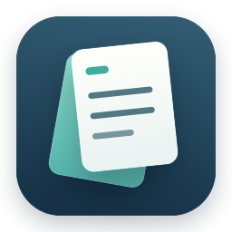

# CopyShelf

Mac에서 전에 복사한 텍스트와 이미지를 다시 꺼내 쓰는 작은 앱입니다. 단축키로 기록을 열고, 검색하거나 방향키로 선택한 뒤 Enter를 누르면 이전 앱에 붙여넣습니다.

앱은 메뉴 막대에서 실행하고 기록은 이 Mac에 저장합니다. 계정, 분석 도구, 네트워크 요청은 없습니다.

[다운로드](https://github.com/jeonchan05/CopyShelf/releases) · [English](../README.md)

## 설치

macOS 13 이상에서 사용할 수 있도록 빌드합니다. Apple Silicon과 Intel 바이너리를 함께 제공하지만, Intel과 macOS 13에서의 실제 실행은 아직 확인하지 않았습니다.

1. GitHub Releases에서 `macOS-unsigned.dmg`를 내려받습니다.
2. DMG를 열고 CopyShelf를 응용 프로그램 폴더로 옮긴 뒤 실행합니다.
3. macOS가 개발자를 확인할 수 없어 실행을 막으면 소스와 다운로드 출처를 확인하세요. 실행하기로 판단한 경우 앱을 한 번 연 뒤 **시스템 설정 → 개인정보 보호 및 보안 → 그래도 열기**에서 해당 앱을 허용합니다. [Apple 실행 안내](https://support.apple.com/ko-kr/102445)에 절차가 있습니다.
4. 자동 붙여넣기를 사용하려면 **개인정보 보호 및 보안 → 손쉬운 사용 → CopyShelf**를 허용합니다. 최신 macOS에서는 **기기 제어 및 데이터 접근**으로 표시될 수 있습니다. 클립보드 읽기 권한을 물으면 **항상 허용**을 선택해야 백그라운드에서 기록합니다.

Apple 공증을 받지 않은 미서명 공개 베타입니다. 앱에는 로컬 무결성 확인용 ad-hoc 서명만 있습니다. GitHub에서 배포해도 macOS의 최초 실행 안내는 나타나며, 업데이트 후 권한을 다시 허용할 수 있습니다. ZIP에는 DMG와 같은 앱이 들어 있습니다. 함께 제공하는 SHA-256 파일로 다운로드를 확인할 수 있습니다.

## 사용

앱을 실행하면 새로 복사하는 내용부터 자동으로 기록합니다. 기본 단축키는 **⌥⌘V**입니다. 메뉴 막대 아이콘을 클릭해도 기록을 열 수 있습니다.

- 검색어를 입력해 텍스트, 이미지 종류, 해상도, 복사한 앱 이름을 찾습니다.
- **↑ / ↓**로 선택하고 **Enter**로 붙여넣습니다. **Esc**는 창을 닫습니다.
- **⌘C**는 선택한 항목을 복사합니다. 검색어 일부를 선택한 상태라면 그 글자를 복사합니다.
- 항목을 두 번 클릭해도 붙여넣습니다.

기록 창에는 검색창, 목록, 짧은 상태 표시와 설정 버튼만 있습니다. 톱니바퀴나 **⌘,**로 설정을 엽니다.

설정의 **기록 열기** 단축키를 클릭하고 원하는 조합을 누르면 변경됩니다. **⌘ 또는 ⌃**를 포함해야 하며 **Esc**로 취소합니다. 변경은 다음 실행에도 유지합니다. 다른 앱과 충돌하는 등 등록에 실패하면 기존 단축키를 유지합니다. **⌘V**는 붙여넣기에 사용하므로 지정할 수 없습니다. 키 표시는 Mac의 물리적인 키 위치를 기준으로 합니다.

설정에서 백그라운드 기록, 로그인 시 자동 실행, 붙여넣기 권한과 기록 삭제를 관리합니다. 메뉴 막대 아이콘의 오른쪽 클릭 메뉴로 빠르게 일시 정지하거나 종료할 수 있습니다. 일시 정지는 다음 실행에도 유지하며, 기록 창을 닫아도 앱은 계속 실행합니다. 로그인 자동 실행은 선택 사항이며 macOS 로그인 항목에서 승인이 필요할 수 있습니다.

## 이미지와 캡처

**⌃⇧⌘4**로 영역을, **⌃⇧⌘3**으로 전체 화면을 클립보드에 캡처합니다. CopyShelf는 복사된 이미지를 읽으므로 화면 기록 권한이 필요하지 않습니다. 파일로 저장한 캡처나 Finder에서 복사한 파일은 가져오지 않습니다. [Apple 캡처 안내](https://support.apple.com/ko-kr/102646)에서 단축키를 확인할 수 있습니다.

이미지는 썸네일과 해상도를 표시합니다. `이미지`, `스크린샷`, `image`, `1920x1080` 같은 해상도나 복사한 앱 이름으로 검색하세요. 이미지 안의 글자를 읽는 OCR은 없습니다. 붙여넣을 곳은 서식 있는 문서나 메시지 입력창처럼 이미지를 받아들여야 합니다.

## 기록과 개인정보

기록은 `~/Library/Application Support/CopyShelf/history.json`에 암호화하지 않은 JSON으로 저장합니다. 파일은 해당 사용자만 접근하도록 권한을 설정하며, 이미지 데이터는 base64로 넣습니다. 최근 200개를 보관하고 같은 내용을 다시 복사하면 맨 위로 올립니다. 텍스트의 공백은 그대로 유지하며 한 항목은 64 KiB까지 기록합니다.

PNG, TIFF, JPEG, HEIC/HEIF, GIF, BMP를 정적인 PNG로 변환합니다. 입력은 32 MiB, 저장 이미지 한 장은 12 MiB, 해상도는 3,200만 화소와 한 변 16,384픽셀까지 허용합니다. 저장 이미지 전체는 32 MiB로 제한합니다. 애니메이션은 첫 프레임만 저장합니다. 파일, 텍스트 서식, 애니메이션 재생과 완전한 HDR 보존은 지원하지 않습니다.

민감한 내용으로 표시된 복사, 일부 비밀번호 관리 앱과 보안 입력 중의 복사는 제외합니다. 이 필터는 복사한 앱에 따라 달라집니다. 별도 표시가 없는 비밀번호, API 키나 개인 캡처는 저장될 수 있으므로 원하지 않는 내용을 복사하기 전에 일시 정지하세요.

**설정 → 기록 지우기**는 확인 후 텍스트와 이미지를 삭제합니다. 현재 클립보드는 유지하며, 삭제 실패는 오류로 표시합니다. 백업이나 저장장치의 이전 데이터까지 지우지는 않습니다. 정상 종료는 대기 중인 저장을 완료하며, 갑작스러운 종료 직전의 최신 기록은 저장되지 않을 수 있습니다.

## 권한이 켜져 있는데 붙여넣기가 안 될 때

앱을 종료하고 다시 실행하세요. 계속 권한을 요청하면 시스템 설정에서 CopyShelf의 오래된 항목만 제거하고, 응용 프로그램 폴더에서 실제로 쓰는 앱을 다시 추가해 허용합니다. 미서명 업데이트는 macOS가 기억한 앱 식별 정보를 바꿀 수 있습니다. 자동 붙여넣기 권한이 없을 때는 ⌘C로 복사한 뒤 ⌘V로 직접 붙여넣습니다.

붙여넣기를 기다리는 중 다른 내용을 복사하면 자동 붙여넣기를 취소합니다. 손쉬운 사용 API가 보안 입력란으로 알려 주는 곳에는 직접 붙여넣도록 합니다.

## 직접 빌드

Swift 6.0 이상과 Apple 개발 도구를 사용합니다.

```sh
swift test
python3 -m unittest discover -s Tests/ReleaseTests -v
bash Scripts/build-app.sh --universal
bash Scripts/package-release.sh
open dist/build/CopyShelf.app
```

결과 앱은 `dist/build`에, 미서명 ZIP·DMG는 `dist`에 만듭니다. 설치된 앱은 교체하지 않습니다. 예시 기록으로만 화면을 확인하려면 다음 명령을 사용하세요.

```sh
open -n dist/build/CopyShelf.app --args --demo
```

[프로젝트 구조](architecture.md) · [GitHub 배포 안내](releasing.md) · [보안](../SECURITY.md) · [MIT 라이선스](../LICENSE)
